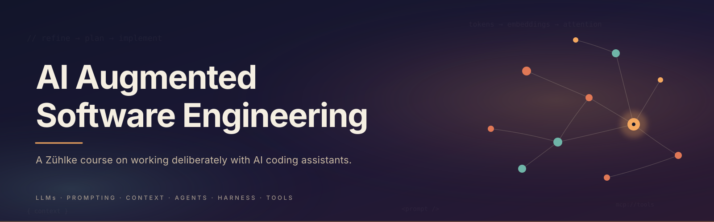

  

# AI Augmented Software Engineering

👋 Welcome! This repository holds the course materials for **AI Augmented Software Engineering**, a Zühlke training that
explores how modern AI tooling changes the way we write and ship software.

The course walks through the theory behind today's AI coding assistants, the workflows that make them reliable, and the
practical patterns you can try the same afternoon.

[[_TOC_]]

## Who this course is for

Software and data engineers at Zühlke who already write code for a living and want a more structured way of working with
AI assistants.

Everyone in the company is welcome to attend. We assume no prior knowledge of LLMs. If you are curious, come along.

## What you will take away

By the end of the course you should be able to:

* Explain in plain language how an LLM produces its next token.
* Pick a model based on the task, instead of defaulting to whatever is newest.
* Write prompts and instruction files that reduce variance in the output.
* Shape context on purpose, instead of throwing everything in and hoping.
* Run a refine, plan, implement loop, and know when to step in.
* Build a deterministic harness around probabilistic agents.
* Wire up external tools through MCP, and write your own when useful.

## Course flavors

The course comes in two flavors. Pick the one that matches the tool you use every day. The theory is the same; the demos
and labs differ.

| Flavor         | Slides                                                                     | Status                              |
|----------------|----------------------------------------------------------------------------|-------------------------------------|
| GitHub Copilot | [Slides](pptx/ai-augmented-software-engineering-course-github-coilot.pptx) | ✅ Ready                             |
| Claude Code    | [Slides](pptx/ai-augmented-software-engineering-course-claude-code.pptx)   | 🚧 Placeholder, content coming soon |

> **Heads up:** the Claude Code slides are still a placeholder. The outline below is tool-neutral and applies to both
> flavors. Each flavor ships its own companion lab repo and realises the concepts with tool-specific artifacts, such as
> `copilot-instructions.md` and prompt files for the Copilot flavor, or `CLAUDE.md`, slash commands, and skills for the
> Claude Code flavor.

## Course outline

A full day, with two short breaks. Every theory block is followed by a demo and, where we have one, a hands-on lab on
the companion training repo.

### 1. Intro

* Goals, target audience, how we will work together.

### 2. Theoretical foundation: large language models

* What an LLM actually is: a transformer trained to predict the next token.
* Tokens: the unit a model operates on, and why word count is the wrong mental model.
* Embeddings: how meaning becomes a vector, and how similarity falls out of that.
* Attention: why word order matters, and how a model resolves "it" in "the animal didn't cross the street because it was
  too tired".

### 3. Different models

* How model size and representation dimensions shape capability.
* 🎬 Demo: choosing the right model for the task.

### 4. Prompt engineering

* Zero-shot, one-shot, and few-shot prompting.
* Chain-of-Thought (CoT) and Zero-Shot CoT ("let's think step by step").
* Prompt templates: reusable, parameterised prompts for recurring tasks.
* 🎬 Demo: a prompt template in action.
* 🧪 **Lab: document the project with a prompt template.** Generate project documentation from a template, then compare
  the output to a written reference.

### 5. Context engineering

* Why a raw LLM falls short: no memory, weak arithmetic, no access to your code.
* What belongs in a context: system prompt, user prompt, tool schemas, retrieved information, conversation history.
* Working memory, and how chat history is fed back into the model every turn.
* Instruction files: repo-wide instructions that shape persona, coding standards, and behaviour, and path-scoped
  instructions that only apply to certain files.
* Context window vs context size, and what happens when the window fills up.
* Context degradation: the Needle-In-A-Haystack (NIAH) benchmark and the lost-in-the-middle effect.
* 🧪 **Lab: set up your project for more consistent output.** Add repo-wide and path-specific instruction files for
  your language and testing setup, then re-implement the same endpoint.

### 6. AI augmented workflow

* The refine → plan → implement loop, and why it beats one-shot prompting.
* Practical habits: time-box AI sessions, protect your cognitive load, accept "80% is good enough", build deterministic
  guardrails.
* Custom agents with dedicated responsibilities, handoffs between them, and reusable skills.
* 🎬 Demo: custom agents with handoffs.
* 🧪 **Lab: agentic workflow.** Define agents for refine, plan, and implement, then re-implement the endpoint under
  that workflow.
* 🧠 An honest look at the new reality of AI augmented engineering: review fatigue, the "just one more prompt" trap, and
  how to stay sharp.

### 7. Agent harness

* Harnessing non-deterministic output with deterministic tools.
* Agent hooks and lifecycle events, for example session start, user prompt submit, pre/post tool use, sub-agent
  start/stop, and stop.
* Agent-scoped hooks for custom agents.
* 🎬 Demo: harnessing output with an agent-scoped hook.
* 🧪 **Lab: agent harness.** (Work in progress.)

> ☕ **15 min break**

### 8. Tools

* How LLMs call tools: tool definition, tool selection, tool calling, output processing.
* Model Context Protocol (MCP), sometimes called "the USB-C port of AI".
* MCP components: MCP server, MCP host, MCP client.
* Subagents: context-isolated helpers that keep the main agent focused.
* 🎬 Demo: integrating a security-scanning tool (for example, Snyk) to check code for vulnerabilities.
* 🧪 **Lab: create a tool.** (Work in progress.)

### 9. Summary

A map of the solution space you now have: prompt engineering for shaping intent, context engineering for shaping what
the model sees, and the agent harness for keeping everything on rails. With a quick look at where MCP and subagents fit
in.

## Getting the most out of the course

* 💻 Bring your laptop with your usual IDE and the AI assistant you actually use.
* 🔑 Make sure your GitHub Copilot or Claude Code access works before we start.
* 📁 Clone the companion training repo the day before so you are ready for the first lab.
* 🧐 Show up curious. Most of the patterns only click once you have tried them on real code.

## Additional resources

* 📋 [Miro board with sketches and references](https://miro.com/app/board/uXjVGmF2-U4=/)
* 📚 Maarten Grootendorst and Jay Alammar, _An Illustrated Guide to AI Agents_ (2026)
* 📘 Jay Alammar and Maarten Grootendorst, _Hands-On Large Language Models_ (2024)
* 🧪 [OpenAI tokenizer](https://platform.openai.com/tokenizer), to see how text gets split into tokens
* 📄 ["Lost in the Middle" paper (arXiv 2307.03172)](https://ar5iv.labs.arxiv.org/html/2307.03172)

## Maintainers

| Name            | Role                         | Contact                                                           |
|-----------------|------------------------------|-------------------------------------------------------------------|
| Marco Romanutti | Lead Software Architect      | [marco.romanutti@zuehlke.com](mailto:marco.romanutti@zuehlke.com) |
| Jonathan Ziller | Principal Software Architect | [jonathan.ziller@zuehlke.com](mailto:jonathan.ziller@zuehlke.com) |
| Lukas Grigis    | Software Engineer            | [lukas.grigis@zuhlke.com](mailto:lukas.grigis@zuhlke.com)         |

## Contributing

🙌 Feedback, corrections, and new modules are all welcome. Open an issue, file a merge request, or drop one of the
maintainers a message. Small fixes (typos, clearer wording, a fresher source) are just as valuable as big additions.

## Usage

Internal Zühlke training material. Please keep it inside the company. 🤝
